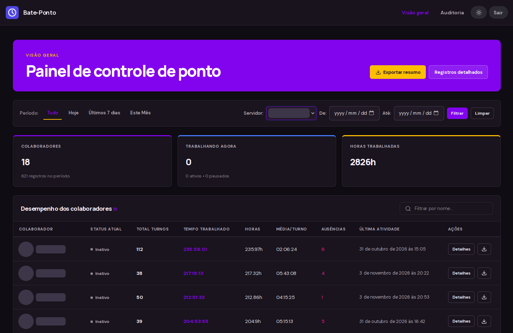
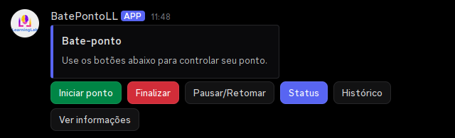
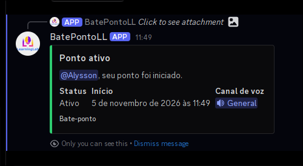
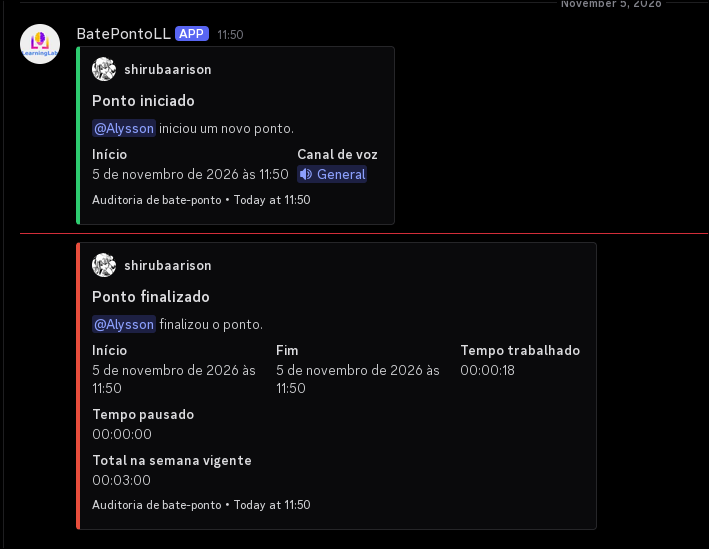
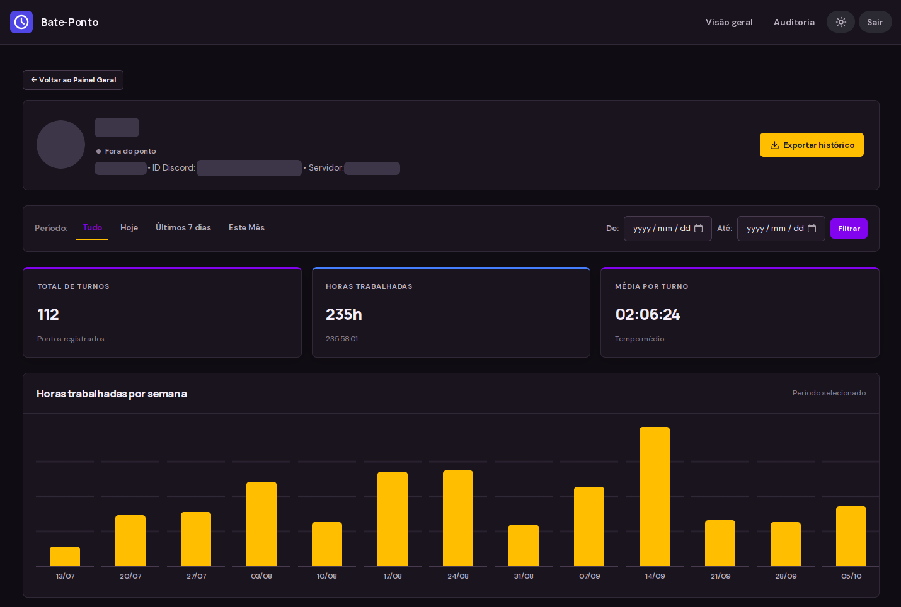
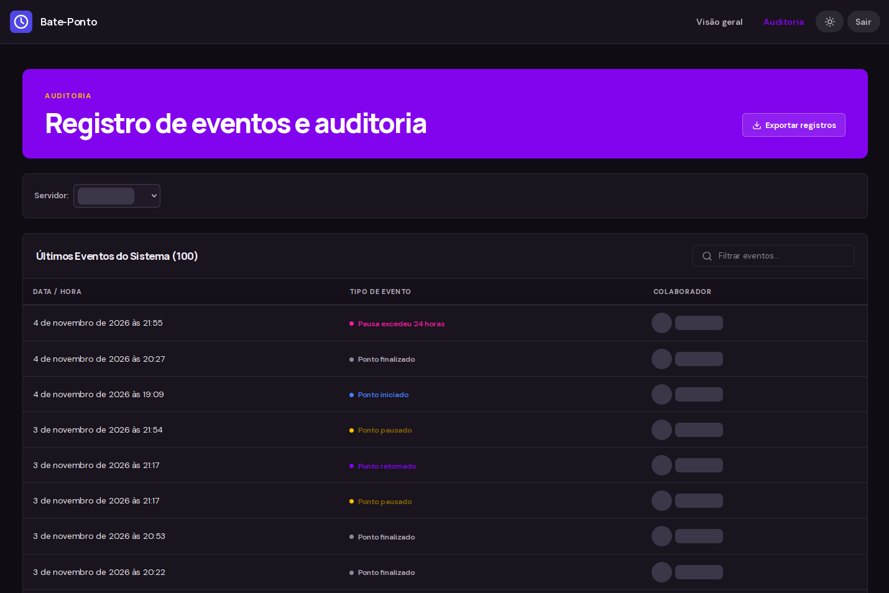

# Bate-Ponto Discord

Controle de ponto direto no Discord, com um painel web onde gestores acompanham as horas da equipe,
corrigem registros e exportam relatórios. Está em produção, usado por servidores reais, com deploy
automático a cada push na `main`.

**Python 3.11+ · discord.py · PostgreSQL · Flask · Alembic · Docker Compose · GitHub Actions · Cloudflare Tunnel**

<p align="center">
  
</p>

## Capturas de tela

| Painel no Discord | Resposta privada ao iniciar o ponto |
| --- | --- |
|  |  |

| Canal de auditoria | Histórico do colaborador |
| --- | --- |
|  |  |

<p align="center">
  
</p>

## O que faz

### Bot

- **Ponto em um clique.** Um painel fixo tem botões para iniciar, finalizar, pausar/retomar, ver o
  status e o histórico. Todas as respostas são efêmeras: só quem clicou vê.
- **Regras de presença.** Só dá para iniciar ou retomar o ponto estando em um canal de voz
  permitido. Se a pessoa sai do canal e não volta dentro da tolerância, o ponto é encerrado no
  horário limite e ela recebe um aviso por DM.
- **Autocorreção.** Pontos ativos ou pausados há mais de 24 horas são encerrados automaticamente.
- **Auditoria no Discord.** Cada início e fim de ponto vai para um canal de logs, com tempo
  trabalhado, tempo pausado e total da semana.
- **Configuração por servidor** com comandos `/config`: canal do painel, canal de logs, canais de
  voz permitidos, tolerância, fuso horário e limpeza automática do canal do painel.
- **Boas-vindas.** Ao entrar em um servidor, o bot envia os passos de configuração.

### Dashboard web

- **Login com Discord (OAuth2).** Cada pessoa vê só os servidores em que é dona ou tem
  `Gerenciar Servidor`, e as permissões são relidas a cada login. Super-admins, definidos por ID
  do Discord, veem todos os servidores.
- **Visão geral da equipe:** quem está trabalhando agora, totais por pessoa e horas por semana, com
  filtros de período que seguem o fuso de cada servidor.
- **Histórico individual** e linha do tempo de eventos de cada ponto.
- **Correção de registros.** Gestores podem editar ou encerrar pontos, e cada alteração fica salva
  numa tabela de auditoria com os valores de antes e depois.
- **Exportação CSV** (resumo, registros e por pessoa) com UTF-8 BOM, para abrir certo no Excel.
- **Segurança:** proteção CSRF, cabeçalhos de segurança, cookies seguros, e o dashboard se recusa a
  iniciar sem uma chave de sessão forte.

## Arquitetura

```
           Gateway do Discord                      Navegador
                  │                                    │  HTTPS
                  ▼                                    ▼
 ┌────────────────────────────┐            Cloudflare Tunnel
 │  bot  (discord.py, async)  │                       │
 │  comandos slash, botões,   │                       ▼
 │  monitor de canais de voz  │       ┌───────────────────────────────┐
 └─────────────┬──────────────┘       │ dashboard (Flask + gunicorn)  │
               │ asyncpg              │ OAuth2 do Discord, CSV        │
               ▼                      └───────────────┬───────────────┘
        ┌──────────────┐                              │ psycopg
        │ PostgreSQL 16│◄─────────────────────────────┘
        └──────────────┘   esquema versionado com Alembic
```

O bot e o dashboard são processos separados, gerados da mesma imagem, e compartilham só o banco. A
VM não expõe nenhuma porta: o dashboard e o SSH do deploy passam por um Cloudflare Tunnel.

### CI/CD

Todo pull request e push roda Ruff, a suíte do pytest e uma validação do Docker Compose. Um push na
`main` também faz o deploy: um runner do GitHub entra na VM por SSH através do túnel, autenticado
com um service token do Cloudflare Access, e roda [`scripts/deploy.sh`](scripts/deploy.sh) (fetch,
build, migrações, containers e verificação do `/healthz`). O `.env` de produção fica só na VM e
nunca passa pela CI.

O passo a passo de configuração está em [`docs/deployment.md`](docs/deployment.md).

## Início rápido (Docker)

```bash
git clone https://github.com/shirubaarison/discord-bateponto-bot && cd discord-bateponto-bot
make env        # cria o .env a partir do .env.example
make secret     # copie o resultado para DASHBOARD_SECRET_KEY
# edite o .env: DISCORD_TOKEN, POSTGRES_PASSWORD, DISCORD_CLIENT_ID/SECRET/REDIRECT_URI
make up         # sobe o banco, roda as migrações e sobe bot e dashboard
```

O dashboard fica em `http://127.0.0.1:5000`. Em produção, coloque-o atrás de HTTPS. Para testar
localmente via HTTP, defina `DASHBOARD_SECURE_COOKIES=false`.

### Criando a aplicação no Discord

1. No [Discord Developer Portal](https://discord.com/developers/applications), crie uma aplicação e
   adicione um bot. Nenhum privileged intent é necessário.
2. Copie o token do bot para `DISCORD_TOKEN`.
3. Em **OAuth2**, copie o Client ID e o Client Secret para `DISCORD_CLIENT_ID` /
   `DISCORD_CLIENT_SECRET` e adicione o redirect `https://<seu-dashboard>/auth/discord/callback`
   (o mesmo valor de `DISCORD_REDIRECT_URI`).
4. Convide o bot com os escopos `bot` e `applications.commands`. Permissões mínimas:
   - Canal do painel: `View Channel`, `Send Messages`, `Manage Messages`
   - Canal de logs: `View Channel`, `Send Messages`
   - Canais de voz permitidos: `View Channel`

### Configurando um servidor

Todos os comandos exigem `Gerenciar Servidor`.

| Comando | Efeito |
| --- | --- |
| `/config painel canal:#canal` | Publica o painel de bate-ponto |
| `/config logs canal:#canal` | Define o canal de auditoria |
| `/config voz-adicionar canal:Canal` | Permite ponto nesse canal de voz |
| `/config voz-remover canal:Canal` | Remove o canal de voz permitido |
| `/config tolerancia minutos:5` | Ajusta a tolerância de ausência |
| `/config fuso fuso:America/Sao_Paulo` | Define o fuso horário do servidor (padrão `America/Fortaleza`) |
| `/config limpeza segundos:30` | Apaga mensagens comuns do canal do painel após esse tempo (`0` desativa) |
| `/config mostrar` | Mostra a configuração atual |

## Desenvolvimento local

Requer [uv](https://docs.astral.sh/uv/) e Docker (para o PostgreSQL).

```bash
make install
make env            # e ajuste no .env: POSTGRES_HOST=localhost
make db             # PostgreSQL via Docker
make migrate
make bot            # em um terminal
make dashboard      # em outro, em http://localhost:5000
```

Para o login com Discord local, adicione `http://localhost:5000/auth/discord/callback` como redirect
no Developer Portal e defina `DASHBOARD_SECURE_COOKIES=false` e `DASHBOARD_PROXY_FIX=false`. Use
`DEV_GUILD_ID` para os comandos slash aparecerem na hora no seu servidor de testes.

Para encher o dashboard com dados de exemplo, `make seed GUILD=<id do servidor> FUSO=Asia/Tokyo`
cria três semanas de pontos no fuso escolhido. Para remover:
`uv run python scripts/seed_demo.py --guild-id <id> --limpar`.

| Alvo | Descrição |
| --- | --- |
| `make check` | Lint + testes (o mesmo que a CI) |
| `make test` | `pytest` |
| `make lint` / `make format` | Ruff |
| `make logs` | Logs dos containers |
| `make down` | Para os containers |

## Configuração

Toda a configuração vem de variáveis de ambiente, validadas com Pydantic na inicialização. O
[`.env.example`](.env.example) documenta cada uma.

| Variável | Descrição |
| --- | --- |
| `DISCORD_TOKEN` | Token do bot (obrigatório) |
| `POSTGRES_*` / `DATABASE_URL` | Conexão com o banco. `POSTGRES_HOST` tem prioridade |
| `DASHBOARD_SECRET_KEY` | Chave de sessão, com 32+ caracteres (obrigatória) |
| `DISCORD_CLIENT_ID` / `DISCORD_CLIENT_SECRET` | Login com Discord via OAuth2 (obrigatório) |
| `DISCORD_REDIRECT_URI` | URL de retorno do OAuth2 cadastrada no Developer Portal |
| `DASHBOARD_URL` | Endereço público do dashboard, citado na mensagem de boas-vindas |
| `DASHBOARD_ADMIN_DISCORD_IDS` | IDs de usuário do Discord, separados por vírgula, que veem todos os servidores |
| `DASHBOARD_SECURE_COOKIES` | `true` exige HTTPS |
| `DASHBOARD_PROXY_FIX` | `true` quando atrás de proxy reverso |
| `DEV_GUILD_ID` | Sincroniza os comandos slash em um único servidor |

## Estrutura

```
bate_ponto_bot/
├── bot.py, commands.py, views.py   # bot, comandos slash e painel de botões
├── db.py, models.py                # acesso ao PostgreSQL (asyncpg)
├── utils.py                        # utilitários de tempo e fuso horário
└── web/                            # dashboard Flask: app, queries, API do Discord, CSV, templates
migrations/                         # Alembic
tests/                              # pytest
scripts/seed_demo.py                # dados de exemplo para o dashboard
scripts/deploy.sh                   # script de deploy rodado na VM pela CI
docs/deployment.md                  # configuração da CI/CD e do Cloudflare Tunnel
```

## Decisões de projeto

- **Por que os avisos automáticos vão por DM?** O Discord só permite mensagens privadas no canal
  como respostas efêmeras a uma interação. Um aviso disparado pela saída de um canal de voz não tem
  interação para responder, então vai por DM.
- **Por que encerrar no horário limite, e não quando a pessoa volta?** Assim as horas ficam
  honestas: o tempo fora do canal de voz além da tolerância nunca é contado.
- **Fuso por servidor.** Os horários são guardados como `timestamptz` e convertidos só na exibição,
  então os filtros "Hoje" e "Este Mês" funcionam para servidores em fusos diferentes.

## Licença

[MIT](LICENSE)
